# Data Visualization of Turkey Population with Plotly

## 1. Introduction

This project implements a data visualization system for Turkey's census data from 1927 to 2023 using Plotly interactive charts and geographic mapping. It analyzes demographic trends across Turkey's 81 provinces: population distribution, gender ratios, and historical changes over nearly a century.

The project targets interactive demographic analysis for uses such as urban planning, resource allocation, policy development, and academic research. Using Plotly, Folium, and geographic data, the system produces dynamic, web-friendly visualizations for detailed examination of population patterns.

It processes census data from TUIK (Turkish Statistical Institute) to create interactive line charts, bar graphs, pie charts, and choropleth maps that show population trends and regional variations.

**Core Features:**
- Historical population analysis for all Turkish provinces (1927-2023)
- Interactive visualizations with zoom, pan, and hover capabilities
- Gender distribution analysis (male/female population ratios)
- Geographic choropleth mapping with Folium
- Focus on Turkey's three largest cities (Istanbul, Ankara, Izmir)
- Comparative analysis of population trends across provinces
- 2023 snapshot analysis with detailed demographic breakdowns

## 2. Methodology / Approach

The system employs Python data analysis libraries (Pandas, NumPy) for data processing and Plotly for interactive visualization. Geographic visualizations use GeoPandas and Folium to create choropleth maps showing population density across Turkish provinces.

### 2.1 System Architecture

The population visualization pipeline consists of:

1. **Data Loading:** Census data from TUIK (1927-2023) in CSV format
2. **Data Processing:** Filtering, sorting, and aggregating population statistics
3. **Temporal Analysis:** Tracking population changes over 96 years
4. **Geographic Analysis:** Mapping population distribution across provinces
5. **Interactive Visualization:** Creating web-ready Plotly charts and Folium maps
6. **Comparative Analysis:** Gender ratios and regional comparisons

### 2.2 Implementation Strategy

The implementation uses Jupyter Notebooks for interactive analysis with two main components: historical analysis (1927-2023) and current snapshot (2023). Data processing includes alphabetical to plate code sorting, gender ratio calculations, and geographic coordinate matching. Plotly provides interactive charts with hover tooltips, while Folium creates interactive maps with province boundaries and population markers.

### 2.3 Mathematical Framework

The analysis employs several mathematical calculations and statistical methods to process and visualize demographic data:

#### 2.3.1 Gender Ratio Calculations

**Male Population Ratio:**

```math
\text{Male\_Ratio} = \frac{\text{Male\_Population}}{\text{Total\_Population}} \times 100
```

**Female Population Ratio:**

```math
\text{Female\_Ratio} = \frac{\text{Female\_Population}}{\text{Total\_Population}} \times 100
```

**Gender Difference:**

```math
\text{Gender\_Difference} = |\text{Male\_Population} - \text{Female\_Population}|
```

#### 2.3.2 Population Growth Rate

**Annual Growth Rate:**

```math
\text{Growth\_Rate} = \frac{\text{Population\_Year}_n - \text{Population\_Year}_{n-1}}{\text{Population\_Year}_{n-1}} \times 100
```

**Compound Annual Growth Rate (CAGR):**

```math
\text{CAGR} = \left[\left(\frac{\text{Population\_Final}}{\text{Population\_Initial}}\right)^{\frac{1}{\text{Years}}} - 1\right] \times 100
```

#### 2.3.3 Statistical Aggregations

**Average Provincial Population:**

```math
\text{Avg\_Population} = \frac{\sum \text{Province\_Populations}}{\text{Number\_of\_Provinces}}
```

**Population Density (when area data available):**

```math
\text{Density} = \frac{\text{Total\_Population}}{\text{Area\_km}^2}
```

#### 2.3.4 Geographic Mapping Calculations

**Choropleth Color Scaling:**

```math
\text{Normalized\_Value} = \frac{\text{Value} - \text{Min\_Value}}{\text{Max\_Value} - \text{Min\_Value}}
```

**Coordinate Transformations:**
- WGS84 coordinate system (EPSG:4326)
- Latitude/Longitude conversions for province centroids

#### 2.3.5 Data Normalization

For comparative visualizations, population data is normalized using:

```math
\text{Normalized\_Population} = \frac{\text{Population} - \text{Mean}}{\text{Standard\_Deviation}}
```

These mathematical frameworks enable accurate demographic analysis, trend identification, and visual representation of population patterns across Turkey's provinces over the 96-year period.

## 3. Requirements

`requirements.txt`

```txt
numpy>=1.19.0
pandas>=1.3.0
plotly>=5.0.0
geopandas>=0.10.0
folium>=0.12.0
```

## 4. Dataset Information

This section provides detailed information about the datasets used in the project.

### 4.1 TR-population.csv

**Description:** Comprehensive census data for all Turkish provinces from 1927 to 2023.

**Structure:**
- **Years Covered:** 1927-2023 (census years)
- **Geographic Coverage:** 81 Turkish provinces
- **Total Records:** 2,301 entries
- **Encoding:** UTF-8

**Columns:**
| Column Name | Turkish Name | Data Type | Description |
|-------------|--------------|-----------|-------------|
| Year | Yıl | Integer | Census year (1927-2023) |
| Province | İl | String | Province name |
| Total | Toplam | Integer | Total population |
| Male | Erkek | Integer | Male population |
| Female | Kadın | Integer | Female population |

**Data Source:** TUIK (Türkiye İstatistik Kurumu - Turkish Statistical Institute)

**Sample Data:**
```
Yıl,İl,Toplam,Erkek,Kadın
2023,İstanbul,15655924,7806787,7849137
2023,Ankara,5803482,2860361,2943121
2023,İzmir,4479525,2221180,2258345
```

### 4.2 TR_map.json

**Description:** Geographic boundary data for Turkish provinces in GeoJSON format.

**Structure:**
- **Format:** GeoJSON
- **Coordinate System:** WGS84 (EPSG:4326)
- **Geographic Features:** Province boundaries, polygons, and multipolygons

**Properties:**
- Province ID (unique identifier)
- Province name (Turkish)
- Geometry data (coordinates for boundaries)

**Usage:** Used for creating choropleth maps and geographic visualizations with Folium.

**Coordinate Reference:**
- Projection: Geographic (latitude/longitude)
- Datum: World Geodetic System 1984 (WGS84)

### 4.3 Data Quality Notes

**Census Years:**
- Regular census intervals vary throughout the period
- Some years have more comprehensive data than others
- Recent years (2000-2023) have more frequent updates

**Data Integrity:**
- All population figures are official TUIK statistics
- Historical data may reflect different provincial boundaries due to administrative changes
- Gender data is complete for all years and provinces

**Known Considerations:**
- Provincial boundaries have changed over time (new provinces created)
- Migration patterns significantly affect urban populations
- 2023 data represents the most recent official census figures

## 5. Installation & Configuration

### 5.1 Environment Setup

```bash
# Clone the repository
git clone https://github.com/kemalkilicaslan/Data-Visualization-of-Turkey-Population-with-Plotly.git
cd Data-Visualization-of-Turkey-Population-with-Plotly

# Install required packages
pip install -r requirements.txt
```

### 5.2 Project Structure

```
Data-Visualization-of-Turkey-Population-with-Plotly
├── Data-Visualisation-of-Turkey-Population-with-Plotly-1927-2023.ipynb
├── Data-Visualisation-of-Turkey-Population-with-Plotly-2023.ipynb
├── TR-population.csv          # Census data (1927-2023)
├── TR-map.json                # Geographic boundary data
├── .gitignore
├── README.md
├── requirements.txt
└── LICENSE
```

## 6. Usage / How to Run

### 6.1 Running Jupyter Notebooks

**Historical Analysis (1927-2023):**

```bash
jupyter notebook Data-Visualisation-of-Turkey-Population-with-Plotly-1927-2023.ipynb
```

**Current Snapshot (2023):**

```bash
jupyter notebook Data-Visualisation-of-Turkey-Population-with-Plotly-2023.ipynb
```

### 6.2 Key Analysis Functions

**Load Census Data:**

```python
import pandas as pd
data = pd.read_csv('TR-population.csv')
```

**Filter by Year:**

```python
data_2023 = data[data['Yıl'] == 2023]
```

**Calculate Gender Ratios:**

```python
data_2023['Erkek_oran'] = data_2023['Erkek'] / data_2023['Toplam']
data_2023['Kadın_oran'] = data_2023['Kadın'] / data_2023['Toplam']
```

**Create Interactive Chart:**

```python
import plotly.express as px

fig = px.line(data, x='Yıl', y='Toplam', 
              title='Turkey Total Population (1927-2023)')
fig.show()
```

**Generate Choropleth Map:**

```python
import folium

turkey_map = folium.Map(location=[38.96, 35.36], zoom_start=6)
folium.Choropleth(
    geo_data='TR_map.json',
    data=data_2023,
    columns=['İl', 'Toplam'],
    key_on='feature.properties.name',
    fill_color='Greys'
).add_to(turkey_map)
turkey_map
```

## 7. Application / Results

### 7.1 Historical Population Trends (1927-2023)

**Total Population Change:**

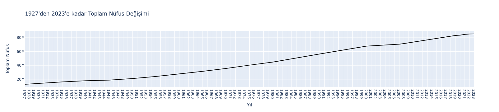

**Male and Female Population Trends:**

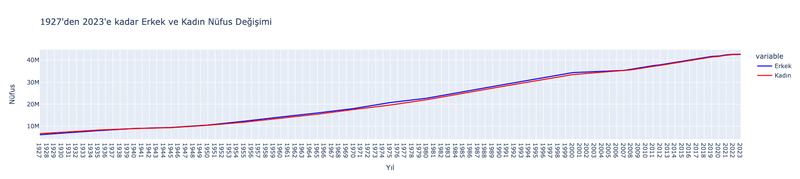

### 7.2 Istanbul Population Analysis (1927-2023)

**Istanbul Demographics:**

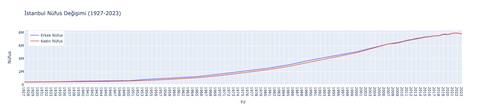

**Key Years - Gender Distribution:**


*1990: Largest male-female gap (288,332 difference)*


*2022: Smallest male-female gap (3,689 difference)*

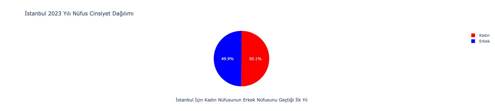

*2023: First year female population exceeded male (42,350 difference)*

### 7.3 Ankara Population Analysis (1927-2023)

**Ankara Demographics:**

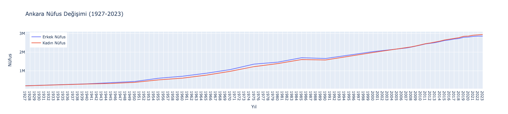

**Key Years - Gender Distribution:**


*1975: Largest male-female gap (133,453 difference)*

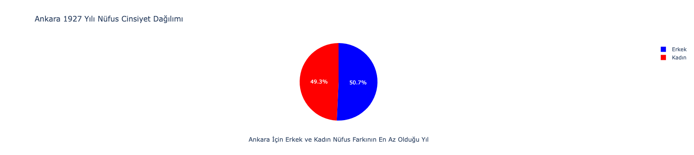

*1927: Smallest male-female gap (6,016 difference)*


*2007: First year female population exceeded male (16,690 difference)*


*2023: Largest female population advantage (82,760 difference)*

### 7.4 Izmir Population Analysis (1927-2023)

**Izmir Demographics:**

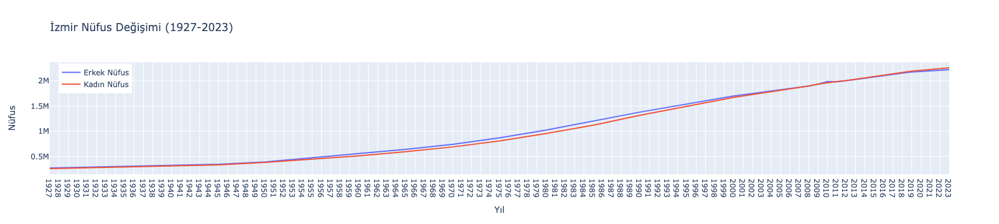

**Key Years - Gender Distribution:**


*1985: Largest male-female gap (78,643 difference)*


*2008: First year female exceeded male, smallest gap (394 difference)*

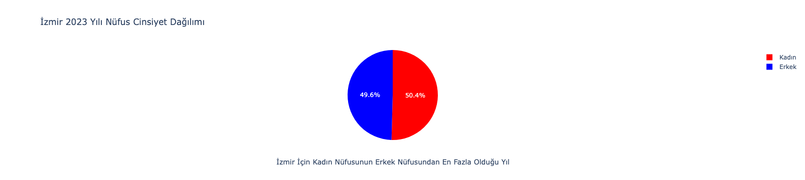

*2023: Largest female population advantage (37,165 difference)*

### 7.5 Three Major Cities Comparison

**Combined Population Trends:**

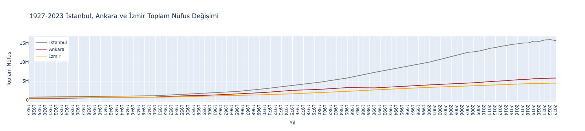

**Male Population Comparison:**

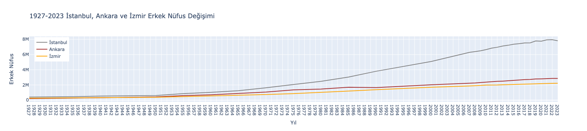

**Female Population Comparison:**

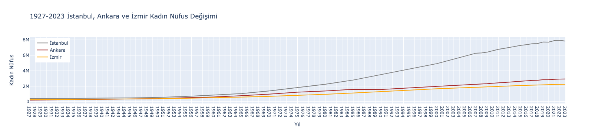

**Historical Snapshots:**

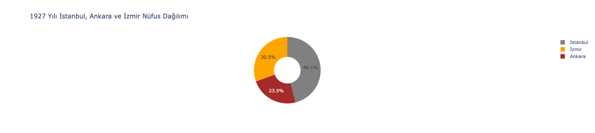

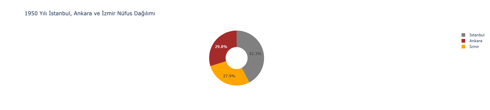

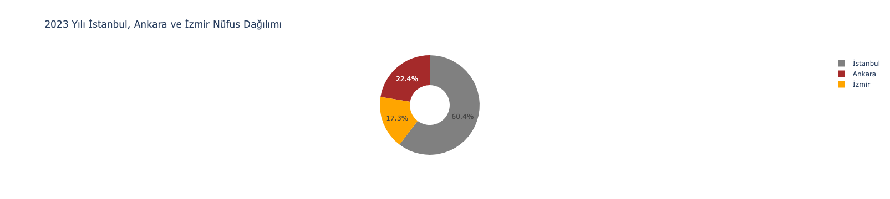

**City Pair Comparisons:**


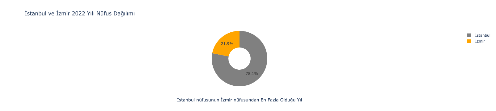

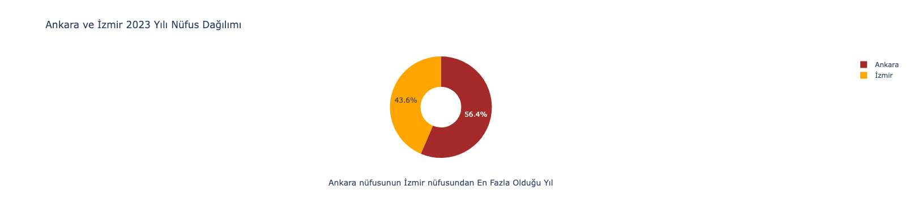
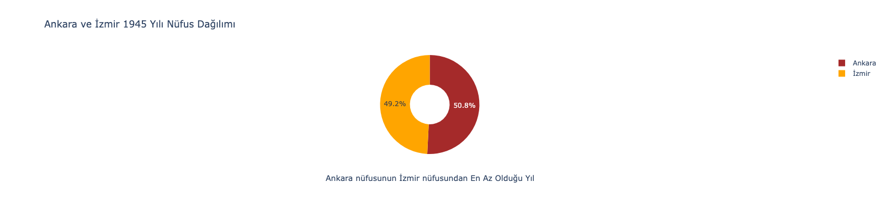

### 7.6 2023 Population Analysis

**All Provinces - Combined:**

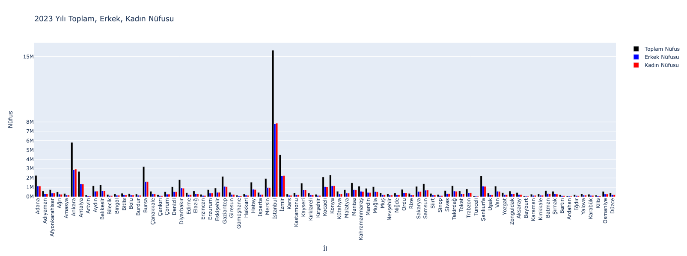

**Individual Categories:**

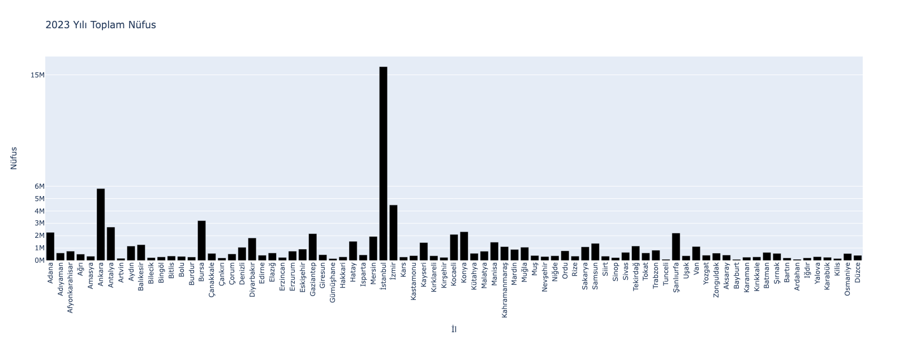
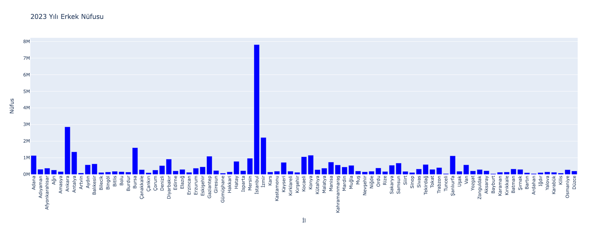
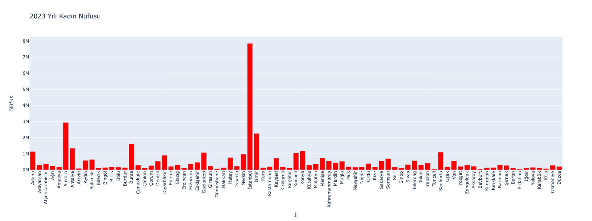

**Gender Ratio Analysis:**

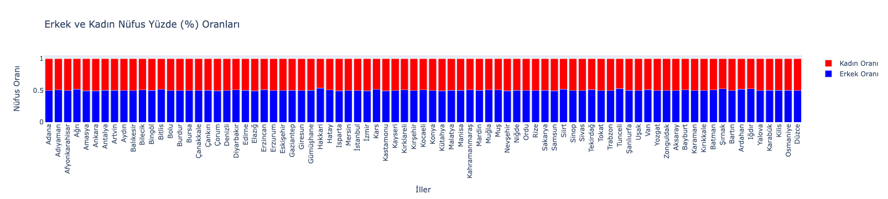

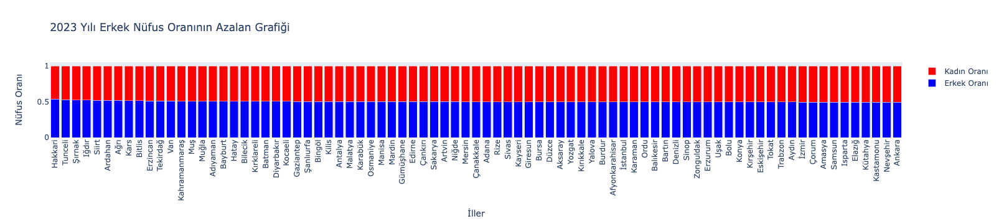

*Highest male ratio: Hakkari (53.62%)*

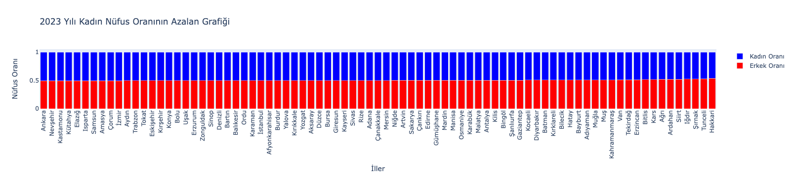

*Highest female ratio: Ankara (50.71%)*

**Population Rankings:**

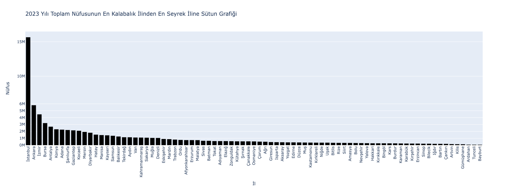

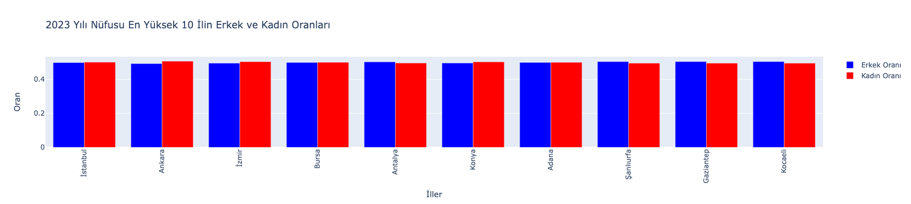

*Most populous: Istanbul (15.66M), Ankara (5.80M), Izmir (4.48M)*

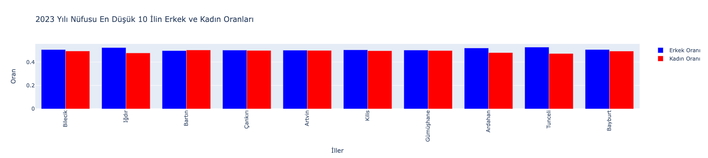

*Least populous: Bayburt (86K), Tunceli (89K), Ardahan (93K)*

### 7.7 Geographic Visualizations

**Total Population Map:**

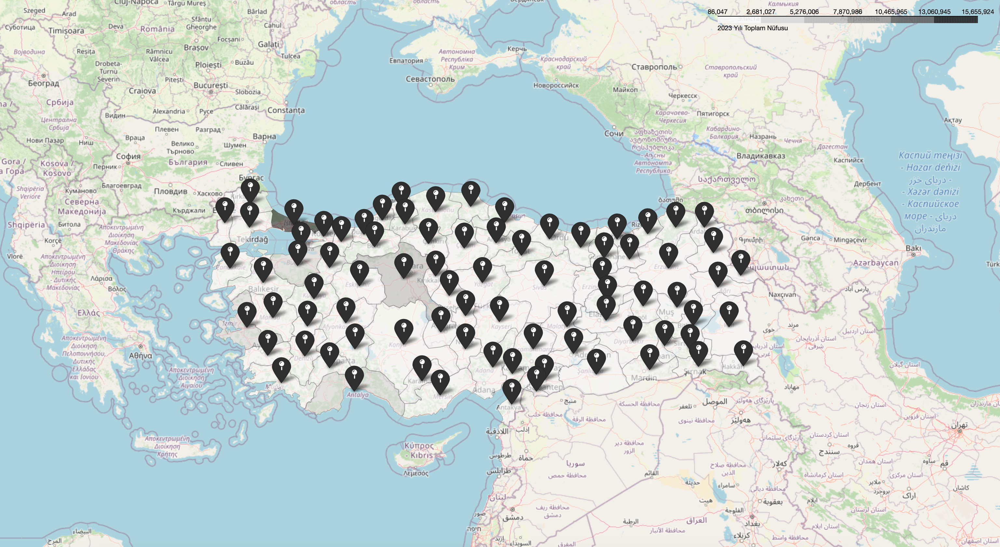

**Male Population Map:**

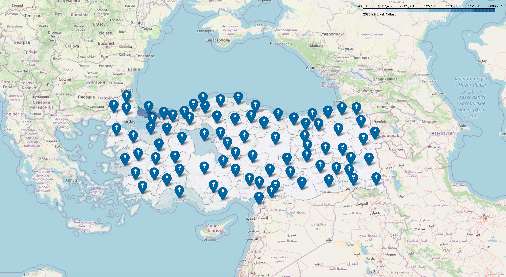

**Female Population Map:**

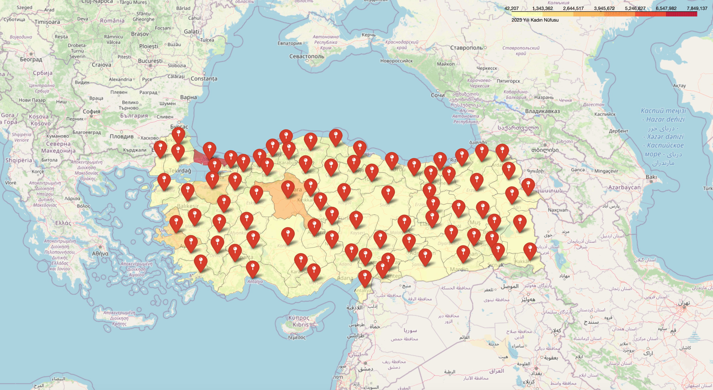

### 7.8 Key Statistical Insights

**National Statistics (2023):**

| Metric | Value |
|--------|-------|
| Total Population | 85,372,377 |
| Male Population | 42,718,072 (50.03%) |
| Female Population | 42,654,305 (49.97%) |
| Number of Provinces | 81 |
| Average Province Population | 1,053,980 |

**Major Cities Population (2023):**

| City | Total | Male | Female | Female Advantage |
|------|-------|------|--------|------------------|
| Istanbul | 15,655,924 | 7,806,787 | 7,849,137 | +42,350 |
| Ankara | 5,803,482 | 2,860,361 | 2,943,121 | +82,760 |
| Izmir | 4,479,525 | 2,221,180 | 2,258,345 | +37,165 |

## 8. Tech Stack

### 8.1 Core Technologies

- **Programming Language:** Python 3.7+
- **Data Processing:** Pandas, NumPy
- **Visualization:** Plotly 5.0+, Folium 0.12+
- **Geospatial:** GeoPandas 0.10+
- **Development Environment:** Jupyter Notebook

### 8.2 Libraries & Dependencies

| Library | Version | Purpose |
|---------|---------|---------|
| pandas | 1.3+ | Data manipulation and analysis |
| numpy | 1.19+ | Numerical operations |
| plotly | 5.0+ | Interactive charts and graphs |
| geopandas | 0.10+ | Geographic data processing |
| folium | 0.12+ | Interactive map generation |

### 8.3 Visualization Types

**Plotly Charts:**
- **Line Charts:** Historical population trends over time
- **Bar Charts:** Provincial comparisons and rankings
- **Pie Charts:** Gender distribution analysis
- **Donut Charts:** Proportional city comparisons
- **Stacked Bar Charts:** Combined gender ratio visualization
- **Grouped Bar Charts:** Side-by-side category comparisons

**Folium Maps:**
- **Choropleth Maps:** Color-coded population density
- **Marker Maps:** Province-specific population data
- **Interactive Features:** Zoom, pan, hover tooltips

### 8.4 Data Format Specifications

**Input Data:**
- CSV format with UTF-8 encoding
- Columns: Yıl (Year), İl (Province), Toplam (Total), Erkek (Male), Kadın (Female)
- GeoJSON for province boundaries

**Output Formats:**
- HTML (interactive Plotly charts)
- HTML (Folium maps)
- PNG (static image exports)

## 9. License

This project is licensed under the [Creative Commons Attribution-NonCommercial-NoDerivatives 4.0 International (CC BY-NC-ND 4.0)](https://github.com/kemalkilicaslan/Data-Visualization-of-Turkey-Population-with-Plotly/blob/main/LICENSE).

## 10. References

1. Turkish Statistical Institute (TUIK). [Population Statistics](https://www.tuik.gov.tr/).
2. Plotly Technologies Inc. [Plotly](https://plotly.com/python/) Python Graphing Library.
3. Folium Development Team. [Folium](https://python-visualization.github.io/folium/) Documentation.
4. [GeoPandas](https://geopandas.org/) Python Tools for Geographic Data.

---

### Acknowledgments

This project uses population census data from TUIK (Türkiye İstatistik Kurumu - Turkish Statistical Institute). Thanks to the open-source communities behind Plotly, Folium, and GeoPandas for their data visualization tools. Geographic boundary data is used for educational and research purposes.

---

**Note:** This project is designed for educational, research, and data analysis purposes. The visualizations and analyses are based on official TUIK census data. When using demographic data for policy or planning purposes, please refer to the official TUIK publications and consider consulting with demographic experts. Population figures are subject to annual updates and revisions by TUIK.